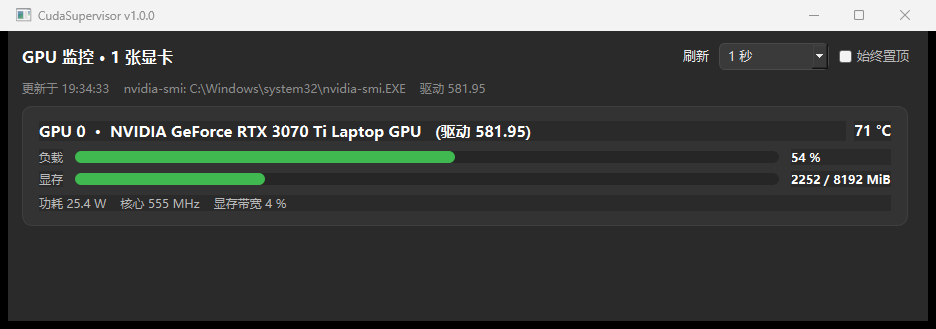

# gpu-guard

Windows 下的 NVIDIA GPU 实时监控小工具（PyQt5），支持多卡，可打包成**免安装单文件 exe**。
最初是一份「把 `nvidia-smi` 文本塞进窗口」的小脚本（见 `nvidia-msi-for-win.py`），
本仓库把它改成了按卡分卡片的监控面板。



## 特性

- **多卡**：解析 `nvidia-smi --query-gpu` 的 CSV 字段，每张卡一张卡片（负载 / 显存 / 温度 / 功耗 / 风扇 / 核心频率），卡的数量随机器自动增减。
- **不卡界面**：采集在 `QThread` 里跑，主线程只负责绘制；刷新间隔可选 0.5 / 1 / 2 / 5 秒。
- **驱动兼容**：查询字段按「全量 → 中量 → 基础」三级降级，老驱动缺 `fan.speed` / `power.draw` 时降级而不是报错；再不行退回整块 `nvidia-smi` 文本显示。
- **中文 Windows 正常**：输出按控制台代码页（GBK）解码，不是硬解 UTF-8。
- **异常有话说**：找不到 `nvidia-smi`（没装驱动 / 不是 N 卡）时显示明确提示，不是空白窗口。
- **可自检**：`--dump` 不开窗口、只采一次数输出，方便排查目标机器环境。
- **窗口自适应**：高度按卡数计算，单卡不会留一大片空白；可切「始终置顶」。

## 直接使用 exe

`python build_exe.py` 生成的 `dist\CudaSupervisor.exe` 可拷到任意 Windows 10/11 x64 机器双击运行，
**目标机器不需要装 Python**，但需要：

- 已安装 NVIDIA 显卡驱动（程序调用驱动自带的 `C:\Windows\System32\nvidia-smi.exe`）。

自检：

```
CudaSupervisor.exe --dump                    :: 结果打到控制台
CudaSupervisor.exe --dump --out D:\gpu.txt   :: 结果写入文件
```

## 从源码运行

```
pip install pyqt5
python cuda_supervisor.py
```

## 打包成 exe

```
python build_exe.py
```

产物 `dist\CudaSupervisor.exe`（约 35 MB）。脚本会检查并安装 `PyQt5` / `pyinstaller`，
写入图标与版本资源，用 `--onefile --windowed` 打包；中间文件落在系统临时目录，
仓库里只多出一个 exe。源码除 PyQt5 外不依赖任何第三方库。

跨机器注意事项：

- 单文件版运行时把 Qt 解到 `%TEMP%`，首启约 1~3 秒；若目标机 `%TEMP%` 只读或有严格杀软/白名单，
  把 `build_exe.py` 里的 `--onefile` 换成 `--onedir`，整目录拷过去更稳妥。
- 驱动过老时功耗/风扇/频率显示 `N/A`，属正常降级。
- 多卡（含 MIG、A100/H100）无需配置，按 `nvidia-smi` 报告的卡序列出。

## 目录

```
cuda_supervisor.py        主程序（多卡监控窗口）
build_exe.py              一键打包脚本（PyInstaller + 图标 + 版本资源）
nvidia-msi-for-win.py     最初的版本，仅保留作对照
docs/screenshot.png       界面截图
skills/                   做这个项目时沉淀的 Hermes 技能
  windows-desktop-app-packaging/
    SKILL.md                      Windows 桌面应用打包与跨机验证流程
    references/qt-live-monitor.md Qt 轮询监控面板配方（线程 / 卡片增删 / 自适应 / nvidia-smi 字段）
    scripts/capture-window.ps1    截取指定窗口（被遮挡也能截，PrintWindow）
```

## 许可

Apache License 2.0，见 [LICENSE](LICENSE)。
